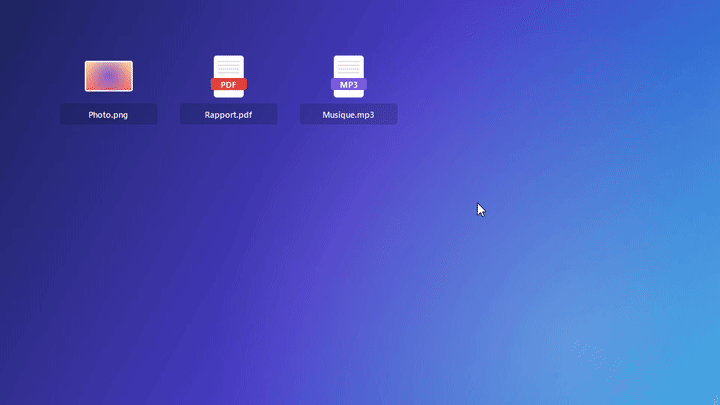
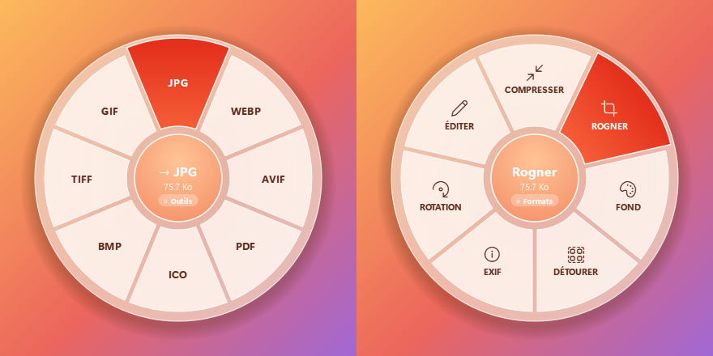
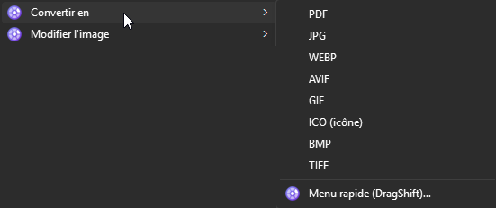
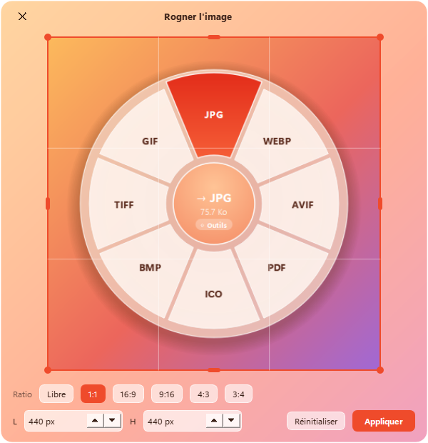
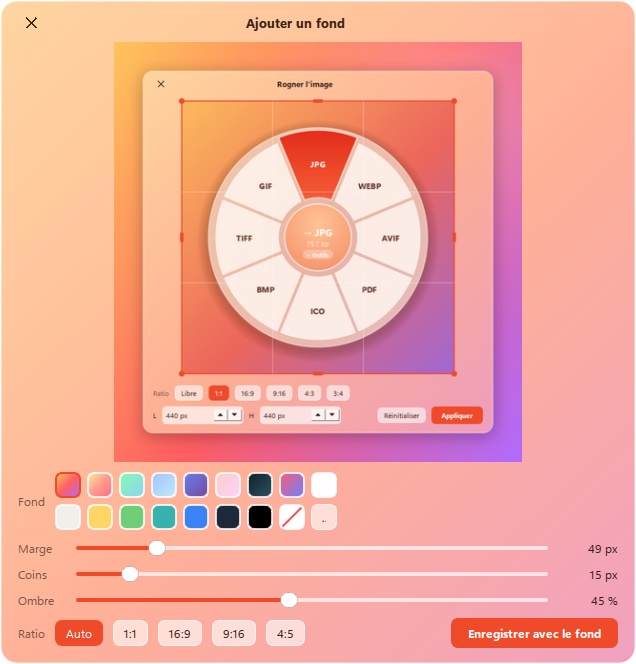

<p align="center">
  
</p>

<h1 align="center">DragShift</h1>

<p align="center">
  Convertis n'importe quel fichier en le glissant… et en appuyant sur <b>Shift</b>.<br>
  Ou tout simplement : <b>clic droit › Convertir en</b>.
</p>

<p align="center">
  
</p>

## Comment ça marche

**1. Glisser + Shift.** Attrape un fichier (Explorateur, Bureau…), appuie sur **Shift** pendant le glisser : un menu rond
apparaît sous la souris. Lâche le fichier sur un format, le fichier converti est créé à côté de l'original.

**2. Réappuie sur Shift** (ou reste une demi-seconde sur le centre) pour passer aux **outils** : rogner, compresser,
ajouter un fond, détourer…

<p align="center"></p>

**3. Ou au clic droit**, sans rien savoir de tout ça : **Convertir en ›** et **Modifier l'image ›** (ou le PDF, la
vidéo, l'audio). Ça marche avec **plusieurs fichiers sélectionnés** : plusieurs images vers PDF, DragShift demande s'il
faut faire *un seul PDF* ou *un PDF par image*.

<p align="center"></p>

> Sous Windows 11, ces entrées sont dans **Afficher d'autres options**, ou directement avec **Shift + clic droit**.

L'original n'est jamais modifié ni déplacé. Tout se fait **en local**, rien n'est envoyé sur Internet.

## Ce que ça sait faire

| Fichier | Convertir en | Outils |
|---|---|---|
| **Image** (PNG, JPG, WEBP, AVIF, HEIC, GIF, TIFF, BMP, ICO…) | PNG, JPG, WEBP, AVIF, PDF, ICO, BMP, TIFF, GIF | Rogner, Compresser, Ajouter un fond, Détourer (IA), Pivoter, Supprimer les métadonnées, Éditer dans Paint |
| **PDF** | Word (DOCX), TXT, JPG, PNG | Compresser, Pivoter, Fusionner plusieurs PDF |
| **Word / LibreOffice** (DOCX, DOC, ODT, RTF) | PDF, DOCX, ODT, TXT, Markdown, HTML | — |
| **PowerPoint / Excel** | PDF, PPTX/ODP, XLSX/ODS/CSV | — |
| **Texte** (MD, TXT, HTML) | Word, PDF, HTML, Markdown, TXT | — |
| **Vidéo** (MP4, MOV, MKV, WEBM, AVI…) | MP4, WEBM, MOV, MKV, GIF animé, MP3, WAV | Compresser, 720p, Couper le son, Miniature, Transcrire en sous-titres (IA) |
| **Audio** (MP3, WAV, FLAC, OGG, M4A, OPUS…) | MP3, WAV, FLAC, OGG, M4A, OPUS | Normaliser le volume, Compresser, Transcrire (IA) |

<p align="center">
  
  
</p>

## Installation

Windows 10 ou 11, et [Python 3.10+](https://www.python.org/downloads/).

```powershell
# 1. Les moteurs de conversion (ImageMagick et ffmpeg sont indispensables, le reste est optionnel)
winget install ImageMagick.ImageMagick Gyan.FFmpeg
winget install TheDocumentFoundation.LibreOffice JohnMacFarlane.Pandoc   # documents Office / texte

# 2. DragShift
git clone https://github.com/maximeoliv/DragShift
cd DragShift
py -m pip install -r requirements.txt

# 3. Ajoute le clic droit + le lancement au démarrage, et démarre
pyw dragshift.pyw --install
```

Une icône apparaît dans la barre des tâches (près de l'horloge) : activer/désactiver, clic droit, démarrage auto, aide.

**Optionnel :** `py -m pip install rembg` pour *Détourer*, `py -m pip install faster-whisper` pour *Transcrire* (utilise la carte
graphique NVIDIA si elle est disponible).

**Désinstaller :** `py dragshift.pyw --uninstall` retire le clic droit et le démarrage auto, puis supprime le dossier.

## Bon à savoir

- **FancyZones (PowerToys)** utilise aussi Shift pendant qu'on déplace une fenêtre : pas de conflit, DragShift ne
  s'ouvre que pendant un vrai glisser-déposer de fichier.
- **Shift pendant un glisser** veut normalement dire « déplacer » pour l'Explorateur : DragShift répond toujours
  « copier », ton fichier reste à sa place.
- Les fichiers produits sont nommés comme dans la démo : `Photo.jpg`, `Photo Compressed.png`, `Photo Cropped.png`,
  `img01 et 20 autres.pdf`… sans jamais écraser un fichier existant.

## D'où vient l'idée

Le geste « glisser + Shift » vient de [**Tangerine**](https://tangerineformac.com/), une app Mac créée par
[thameem (@th2049)](https://x.com/th2049). DragShift est une réimplémentation indépendante pour Windows, écrite de zéro
et sans lien avec Tangerine. **Si tu es sur Mac, utilise l'original.**

## Licence

[MIT](LICENSE).
