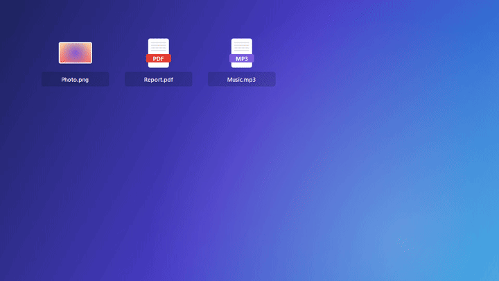
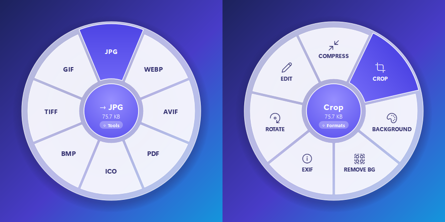
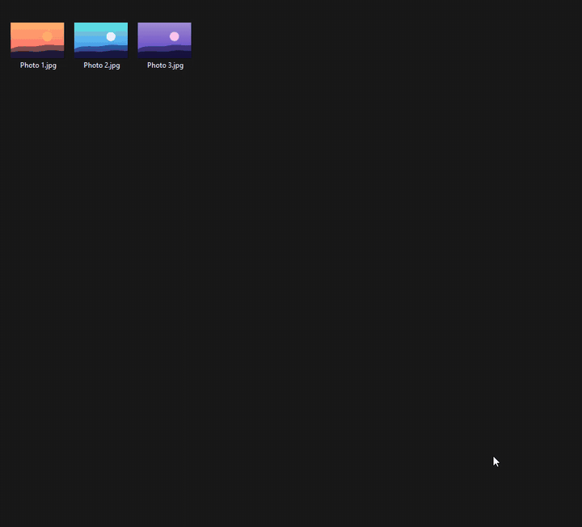
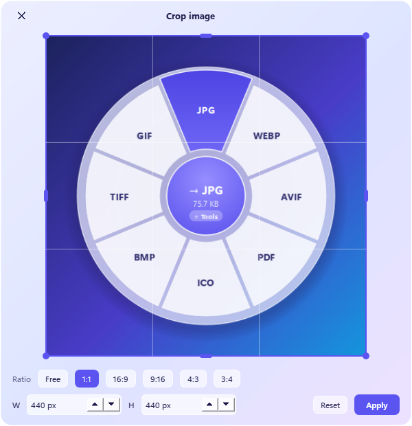
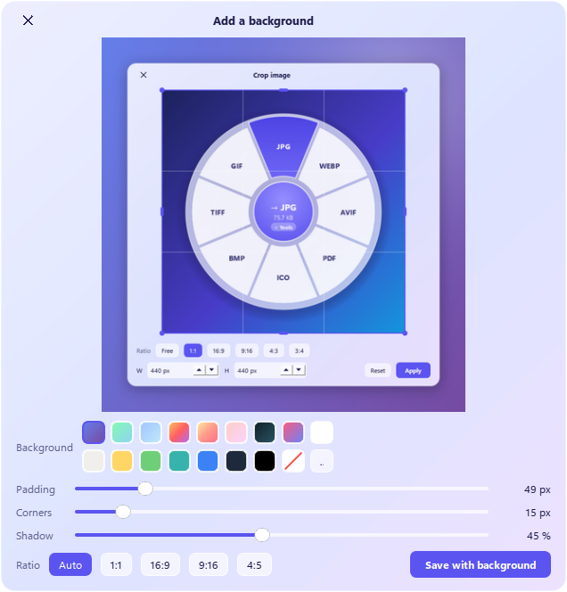

<p align="center">
  
</p>

<h1 align="center">DragShift</h1>

<p align="center">
  Convert any file by dragging it… and pressing <b>Shift</b>.<br>
  Or just: <b>right-click › Convert to</b>.
</p>

<p align="center"><b>English</b> · <a href="README.fr.md">Français</a></p>

<p align="center">
  
</p>

## How it works

**1. Drag + Shift.** Grab a file (File Explorer, desktop…) and press **Shift** while dragging: a round menu appears
under the mouse. Drop the file on a format, and the converted file is created next to the original.

**2. Press Shift again** (or rest on the center for half a second) to switch to the **tools**: crop, compress,
add a background, remove the background…

<p align="center"></p>

**3. Or right-click**, no gesture to remember: **Convert to ›** and **Edit image ›** (or PDF, video, audio).
It works with **several selected files**: for several images to PDF, DragShift asks whether you want *one PDF*
or *one PDF per image*.

<p align="center"></p>

> **Windows 11:** the entries show up directly in the new menu if **Developer Mode** is on
> (*Settings › System › For developers*), see [why](#good-to-know). Otherwise, and on Windows 10, they are in the
> classic menu (*Show more options*, or straight away with **Shift + right-click**).

The original file is never changed or moved. Everything runs **locally**, nothing is sent over the Internet.

## What it can do

| File | Convert to | Tools |
|---|---|---|
| **Image** (PNG, JPG, WEBP, AVIF, HEIC, GIF, TIFF, BMP, ICO…) | PNG, JPG, WEBP, AVIF, PDF, ICO, BMP, TIFF, GIF | Crop, Compress, Add a background, Remove background (AI), Rotate, Remove metadata, Edit in Paint |
| **PDF** | Word (DOCX), TXT, JPG, PNG | Compress, Rotate, Merge several PDFs |
| **Word / LibreOffice** (DOCX, DOC, ODT, RTF) | PDF, DOCX, ODT, TXT, Markdown, HTML | — |
| **PowerPoint / Excel** | PDF, PPTX/ODP, XLSX/ODS/CSV | — |
| **Text** (MD, TXT, HTML) | Word, PDF, HTML, Markdown, TXT | — |
| **Video** (MP4, MOV, MKV, WEBM, AVI…) | MP4, WEBM, MOV, MKV, animated GIF, MP3, WAV | Compress, 720p, Mute, Thumbnail, Transcribe to subtitles (AI) |
| **Audio** (MP3, WAV, FLAC, OGG, M4A, OPUS…) | MP3, WAV, FLAC, OGG, M4A, OPUS | Normalize volume, Compress, Transcribe (AI) |

<p align="center">
  
  
</p>

## Installation

Windows 10 or 11, and [Python 3.10+](https://www.python.org/downloads/).

```powershell
# 1. The conversion engines (ImageMagick and ffmpeg are required, the rest is optional)
winget install ImageMagick.ImageMagick Gyan.FFmpeg
winget install TheDocumentFoundation.LibreOffice JohnMacFarlane.Pandoc   # Office / text documents

# 2. DragShift
git clone https://github.com/maximeoliv/DragShift
cd DragShift
py -m pip install -r requirements.txt

# 3. Add the right-click menu + start with Windows, and launch it
pyw dragshift.pyw --install
```

To get the entries in the **new Windows 11 menu**, turn on Developer Mode *before* step 3
(*Settings › System › For developers › Developer Mode*). Without it, everything still works through the classic menu.

An icon appears in the taskbar (near the clock): turn it on/off, right-click menu, start with Windows, help.

**Optional:** `py -m pip install rembg` for *Remove background*, `py -m pip install faster-whisper` for *Transcribe*
(uses an NVIDIA graphics card if there is one).

**Uninstall:** `py dragshift.pyw --uninstall` removes the right-click menu and the autostart, then delete the folder.

## Good to know

- **Language:** the interface is in English, or in French if Windows is in French. To force it:
  `setx DRAGSHIFT_LANG en` (or `fr`), quit DragShift (icon near the clock › Quit), then start it again from a
  **new** terminal with `pyw dragshift.pyw`. The right-click menu updates by itself.
- **Why Developer Mode for the Windows 11 menu?** The new menu only accepts extensions shipped in a signed Windows
  package. DragShift registers a small, unsigned local package ([`winmenu/`](winmenu/): a C++ DLL and its source
  code), which Windows only allows in Developer Mode. The binaries are included; to rebuild them:
  [`winmenu/build.sh`](winmenu/build.sh) with [llvm-mingw](https://github.com/mstorsjo/llvm-mingw).
- **FancyZones (PowerToys)** also uses Shift while you move a window: no conflict, DragShift only opens during an
  actual file drag and drop.
- **Shift while dragging** normally means "move" to File Explorer: DragShift always answers "copy", so your file
  stays where it is.
- Output files are named like in the demo: `Photo.jpg`, `Photo Compressed.png`, `Photo Cropped.png`,
  `img01 and 20 others.pdf`… and an existing file is never overwritten.

## Where the idea comes from

The "drag + Shift" gesture comes from [**Tangerine**](https://tangerineformac.com/), a Mac app made by
[thameem (@th2049)](https://x.com/th2049). DragShift is an independent reimplementation for Windows, written from
scratch and not affiliated with Tangerine. **If you're on a Mac, use the original.**

## License

[MIT](LICENSE).
